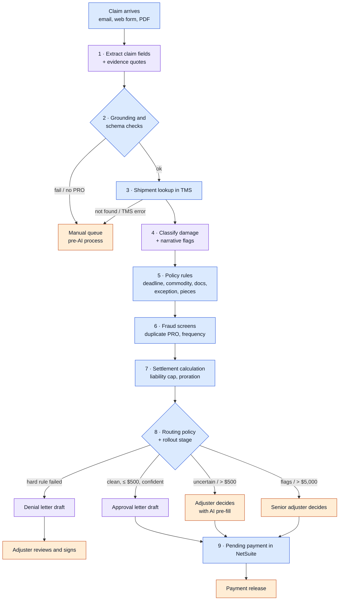
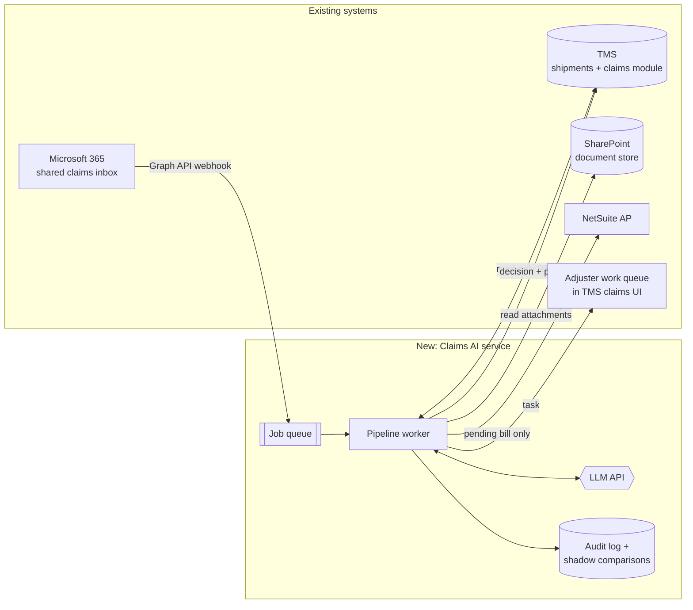

# Meridian Freight: AI in the Freight Claims Workflow

An FDE-style engagement write-up for a fictional company. It maps a real-world
workflow step by step, decides where an LLM belongs (and where it doesn't),
and lays out how to ship it into the systems the company already runs, using
the core loop of **audit → evals → deployment**. Runnable Python backs every
decision.

> **The company.** Meridian Freight is a fictional mid-size LTL (less-than-truckload)
> carrier: 40 terminals, ~1,850 cargo damage and shortage claims a month, handled
> by 7 claims adjusters. Freight claims are a good test case because they mix
> messy customer emails, hard legal rules (the Carmack Amendment), money, and
> a real fraud incentive.

**Contents:**
[1. Audit](#1-audit-what-the-work-actually-is) ·
[2. Workflow map](#2-workflow-map) ·
[3. Where AI goes, and why](#3-where-ai-goes-and-why) ·
[4. Evals](#4-evals) ·
[5. Deployment strategy](#5-deployment-strategy) ·
[6. Error handling](#6-error-handling) ·
[7. Code tour](#7-code-tour) ·
[8. Run it](#8-run-it)

---

## 1. Audit: what the work actually is

Before choosing any technology, an FDE sits with the adjusters and measures.
Findings from a (fictional) two-week audit of 400 claims:

| Where adjuster time goes | Share of time | What it is |
|---|---|---|
| Reading emails and keying claim data | 34% | PRO number, amounts, pieces, contacts copied from email/PDF into the TMS |
| Chasing missing documents | 18% | Emailing claimants for invoices and photos |
| Looking up the shipment | 12% | Matching the PRO in the TMS, reading the driver's delivery notes |
| **Actual judgment** | **22%** | Liability, damage plausibility, fraud suspicion, negotiation |
| Writing decision letters | 9% | Mostly copy-paste from Word templates |
| Payment entry | 5% | Re-keying approved amounts into NetSuite |

Other findings that shaped the design:

- **Median cycle time is 11 days**, and 60% of that is the claim sitting in a queue, not being worked.
- **6% of claims have a keying error** in the PRO number or amount, caught later (or not).
- **~45% of claims are under $500** and are approved with no real deliberation.
- **Denials and large claims get disputed**, and every denial must cite a specific tariff or legal reason.
- The claims manager's top fear is **paying a fraudulent or duplicate claim automatically**.

**Goal agreed with the claims manager:** move adjuster time from typing to judgment,
cut cycle time for small clean claims to under 1 day, and never let the system
pay or deny a claim on a model's say-so.

## 2. Workflow map

Every step is tagged with one of three types:

- 🟦 **DET** (deterministic): rules, lookups and arithmetic. Same input, same output, explainable.
- 🟪 **LLM** (model judgment): unstructured language in, validated structured data out.
- 🟧 **HITL** (human-in-the-loop): a person decides, approves, or signs.



### Step by step

| # | Step | Type | Today (manual) | With this design | Why this type | Code |
|---|---|---|---|---|---|---|
| 0 | Receive claim | DET | Adjuster opens shared inbox | Inbox webhook enqueues the message | Plumbing | `integrations.py` |
| 1 | Extract fields | 🟪 LLM | Adjuster reads and types | Model returns JSON + verbatim evidence quotes | Free-form emails in many styles; errors are checkable downstream | `ai_steps.extract_claim` |
| 2 | Grounding and schema checks | 🟦 DET | n/a | Every quote must appear in the email; types and ranges validated | Catches hallucinations cheaply and exactly | `ai_steps.check_grounding` |
| 3 | Shipment lookup | 🟦 DET | Adjuster searches TMS | API call by PRO number | The TMS is the system of record; never infer what you can look up | `TMSAdapter` |
| 4 | Classify damage, flag inconsistencies | 🟪 LLM | Adjuster reads story vs. driver notes | Damage type + "does the story match?" + flags | Comparing two narratives is language judgment; output only **flags**, never a verdict | `ai_steps.classify_damage` |
| 5 | Policy rules | 🟦 DET | Adjuster remembers the tariff | Filing deadline, excluded commodities, required documents, exception notation, piece counts | Law and tariff must be applied identically and cited in denials | `rules.py` |
| 6 | Fraud screens | 🟦 DET | Adjuster's memory | Duplicate PRO, claimant frequency | Exact matches on history are a query, not a judgment | `rules.check_claim_history` |
| 7 | Settlement | 🟦 DET | Calculator | `min(claimed, liability cap × affected/total pieces)` | Money is arithmetic. An LLM here adds risk and nothing else | `rules.settlement_amount` |
| 8 | Routing | 🟦 DET | Everything goes to an adjuster | Policy table over rule results, AI confidence, amount, and rollout stage | Who acts is a business decision owned by the claims manager, tuned from evals | `router.py`, `deployment.py` |
| 9a | Decide (large, flagged, uncertain) | 🟧 HITL | Adjuster | Adjuster or senior adjuster, with the file pre-filled | Liability judgment, negotiation, fraud, and anything disputed | `ReviewQueueAdapter` |
| 9b | Letter | 🟪 LLM + DET | Word templates | Model writes one warm paragraph; amounts and legal text come from a fixed template | Tone benefits from a model; legal wording must not vary | `pipeline.LETTER_TEMPLATES` |
| 9c | Sign denials | 🟧 HITL | Adjuster | Adjuster reviews and sends every denial | Denials are disputed and have legal weight | `Route.AUTO_DENY_DRAFT` |
| 10 | Payment | 🟦 DET → 🟧 HITL | Re-keyed into NetSuite | Bill created as *pending*; a person releases it | Money movement stays a human click, exactly as today | `ERPAdapter` |

## 3. Where AI goes, and why

The test applied to every step:

| Question | If yes |
|---|---|
| Can the rule be written down and must it be explainable line by line (law, tariff, money)? | **Deterministic** |
| Is the input unstructured language, and can a wrong output be **caught** (by a check, a lookup, or a reviewer) before it costs anything? | **LLM**, with validation |
| Is the action irreversible, high value, adversarial, or legally weighty? | **Human** decides; AI only prepares the file |

Decisions that follow from it:

- **Only 3 of 13 steps use an LLM**: extraction, damage classification, and letter tone. They target reading, typing and letter writing (43% of adjuster time). Plain deterministic automation covers lookup, document checks and payment entry (another 35%).
- **The model never decides money or liability.** It outputs facts with evidence and flags. Rules compute; people decide.
- **Every LLM output is checked by deterministic code** before use: schema validation, grounding of quotes against the source, range checks, and a cross-check against the TMS record.
- **Confidence is a routing input, not a verdict.** Thresholds (0.85 extraction, 0.80 classification) are set from eval results, not intuition.
- **Auto-approval is narrow on purpose**: ≤ $500, every rule passed, no flags, fully grounded, confident. That is ~45% of volume with little downside, and the payment is still released by a person.
- **What I chose not to automate**: liability decisions on disputed claims, fraud verdicts, and negotiation. They're 22% of time and the reason adjusters exist. AI that "helps" there mostly adds risk.

## 4. Evals

`evals/golden_set.jsonl` holds historical claims labelled by adjusters with the
correct PRO, amount, damage type, and route. The harness runs the full pipeline
on each and scores each AI step separately as well as the end-to-end route.

| Metric | Gate | Why this gate |
|---|---|---|
| `unsafe_auto_approvals` | **= 0** | Auto-paying a claim a human wouldn't have is the failure the business can't accept |
| `pro_number_accuracy` | ≥ 0.95 | Wrong PRO = wrong shipment = wrong money |
| `claimed_amount_accuracy` | ≥ 0.95 | Same |
| `damage_type_accuracy` | ≥ 0.80 | Lower bar: most of these are reviewed by a person anyway |
| `route_agreement` | ≥ 0.80 | System routes like an experienced adjuster would |
| `automation_rate` | reported | The value side: share of claims that skip the queue |

The harness exits non-zero when a gate fails, so in production it runs in CI
against the real model on every change to a prompt, model, threshold or rule.
(The repo's own CI runs the unit tests and the demo; it has no API key.)

**Current result (offline stub model):** the stub is a regex imitation of a model
and misses the PRO number written as `pro# 4410-2291` in case G10. The harness
reports `pro_number_accuracy = 0.90` and **blocks the release**, while
`unsafe_auto_approvals` stays at 0 because the miss falls back to a human. That
is the intended behaviour: a weak model costs automation, not money. Running
with a real model (`ANTHROPIC_API_KEY` set) is the comparison that decides the
model choice.

In production the golden set grows to ~500 claims, sampled across claim types
and terminals, and is refreshed monthly from adjuster overrides (see monitoring).

## 5. Deployment strategy

### Architecture: AI sits between existing systems, replacing none



### Integration points

| System | Direction | Mechanism | What flows | Rationale |
|---|---|---|---|---|
| Microsoft 365 inbox | in | Graph API change notifications → job queue | New claim emails and form submissions | No change for claimants; the queue absorbs bursts and makes processing retryable |
| TMS shipments | read | REST, read-only service key | Shipment record by PRO | System of record; read-only key means the AI service cannot corrupt it |
| TMS claims module | read/write | REST, upsert by claim ID | Claim history in; decisions and AI pre-fill out | Adjusters keep working in the screen they know; idempotent writes make retries safe |
| SharePoint | read | Graph API | Attachments, already tagged by type on upload | Document completeness stays deterministic |
| Adjuster queue | write | TMS task API | Task with reasons and an AI side panel (accept / edit / reject per field) | The accept/edit/reject clicks are free labelled data for evals |
| NetSuite AP | write | Vendor bill API, **pending approval** status | Approved amount | Release to payment stays a human click; the AI service has no permission to pay |
| LLM API | out | Behind `LLMClient` interface, zero-data-retention terms | Claim text only; no bank details | Model is swappable; evals can replay recorded outputs |

### Rollout phases

| Phase | Mode | What changes for people | Exit criteria |
|---|---|---|---|
| 0 · Audit + golden set | n/a | Adjusters label 500 historical claims | Gates agreed; baseline metrics recorded |
| 1 · Shadow (4 weeks) | `SHADOW` | Nothing. AI runs on live claims and logs what it *would* do | Gates pass on live traffic; shadow route matches adjuster decisions ≥ 80%; zero would-be unsafe approvals |
| 2 · Assist (4 weeks) | `ASSIST` | Every claim still goes to a person, but pre-filled | Field edit rate < 5%; adjuster time per claim down; no rise in disputes |
| 3 · Canary auto-approve | `AUTO`, canary 10% → 50% → 100% | Small clean claims in the canary skip the queue (payment still released by a person) | Weekly audit of 50 auto-approved claims finds no errors; override rate stable |

Mode and canary percentage are environment config (`deployment.py`); canary
bucketing is a stable hash of the claim ID, so retries never flip a claim
between paths. `MERIDIAN_AI_KILL_SWITCH=1` returns everything to the pre-AI
process instantly.

### Monitoring after launch

- **Override rate**: how often adjusters edit an AI field or overturn a route. Rising = drift.
- **Unsafe approvals** from the weekly human audit of auto-approved claims. Any one triggers a rollback to `ASSIST` and an eval case.
- **Fallback rate**: share of claims hitting the manual path because of AI errors or an open circuit breaker.
- **Cycle time and adjuster hours per claim**: the business outcome.
- Every adjuster correction is appended to the golden set candidates, so the evals keep up with new claim patterns.

### Security and compliance

- Least privilege: read-only TMS key, NetSuite role limited to creating pending bills.
- Full audit log per claim: inputs, model outputs, rule results, route, and who acted.
- Claimants' bank details never go to the model; payment data stays in NetSuite.
- Every denial is signed by a person and cites a tariff rule, so it's defensible.

## 6. Error handling

The rule: **an AI failure never blocks or decides a claim.** Every failure ends in a retry or in the manual queue, which is how Meridian worked before this project.

| Failure | Detection | Handling | Code |
|---|---|---|---|
| Model timeout, rate limit, 5xx | Exception from client | Retry with exponential backoff + jitter (3 attempts), then manual queue | `errors.with_retries` |
| Model outage | 5 consecutive failures | Circuit breaker opens for 60 s; all claims go manual without calling the model | `errors.CircuitBreaker` |
| Invalid JSON / wrong types / bad enum | Schema validation | `MalformedOutputError` → retried, then manual | `ai_steps.extract_claim` |
| Hallucinated value | Evidence quote not in source, or money field without a quote | Recorded as grounding failure → adjuster review | `ai_steps.check_grounding` |
| Low confidence | Below eval-derived threshold | Adjuster review with pre-fill | `router.route_claim` |
| Missing / unknown PRO | Null PRO or TMS miss | Manual queue with reason | `pipeline.process` |
| Bad data in the TMS | Parse error on the record | `SystemOfRecordError`, not retried, escalated; never patched by a model | `TMSAdapter` |
| Model writes amounts in the letter | `$` or length check | Fixed fallback sentence | `ai_steps.draft_letter_paragraph` |
| Duplicate processing on retry | Same claim ID | Idempotent upserts in claims DB and ERP | `integrations.py` |

## 7. Code tour

```
meridian_claims/
  pipeline.py      the workflow end to end; each step tagged [DET] / [LLM] / [HITL]
  ai_steps.py      the 3 LLM steps: prompts, schema validation, grounding
  rules.py         deterministic policy, fraud screens, settlement math
  router.py        human-in-the-loop routing policy
  deployment.py    shadow / assist / auto modes, canary, kill switch
  errors.py        error taxonomy, retries, circuit breaker
  integrations.py  adapters for the TMS, claims DB, review queue, NetSuite
  llm.py           LLMClient interface, Anthropic client, offline stub
  models.py        typed records passed between steps
evals/             golden set + harness with ship gates
examples/demo.py   three claims through the pipeline
tests/             unit tests for rules, validation, retries, rollout, fallbacks
data/              sample TMS shipments and claim history
```

Start with `pipeline.py`: it reads top to bottom as the workflow map above.

## 8. Run it

Python 3.10+, no dependencies for the offline mode.

```bash
python -m examples.demo                 # 3 claims, shows routes, rules, letters, side effects
python -m evals.run_evals               # scores the golden set and applies ship gates
python -m unittest discover tests       # 19 unit tests
```

With a real model:

```bash
pip install anthropic
export ANTHROPIC_API_KEY=...            # MERIDIAN_MODEL overrides the default model
python -m evals.run_evals
```

## Assumptions and next steps

- Meridian, its numbers and its systems are fictional but modelled on how mid-size LTL carriers commonly operate. The Carmack 9-month filing minimum is real; the 5-day concealed-damage window is a typical tariff term.
- Next: photo analysis (a vision model checking that photos show the claimed damage) is a natural fourth AI step, gated behind the same evals; and salvage value estimation, which would stay deterministic from a price table.
